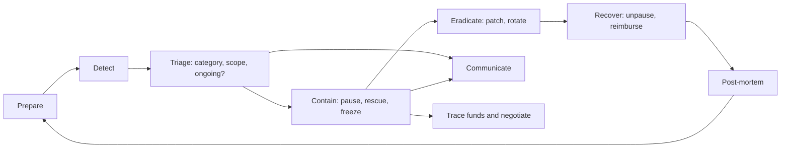

# Why On-Chain Incident Response Is Different

Traditional incident response assumes that defenders control the systems under attack. They can isolate a host, revoke credentials, restore from backup and, in the worst case, roll back a database. On public blockchains most of those levers are missing. Transactions are final within minutes, contracts may be immutable, assets move across chains and through mixers in hours, and the attacker can watch your response in real time on the same public ledger. This book adapts the classic incident response cycle to that environment.

## The classic cycle, adjusted

NIST SP 800-61 describes incident handling as preparation; detection and analysis; containment, eradication and recovery; and post-incident activity. The phases still apply, but their weight shifts.

| Phase | Traditional emphasis | On-chain emphasis |
|---|---|---|
| Preparation | Tooling, logging, playbooks | Pause roles, guardians, signer readiness, pre-agreed contacts — almost everything must be decided in advance |
| Detection | SIEM alerts | Mempool and on-chain monitoring, community reports, often minutes before or after the first exploit transaction |
| Containment | Isolate hosts | Pause contracts, revoke approvals, rescue remaining funds, ask exchanges and issuers to freeze |
| Eradication | Remove malware | Patch or upgrade contracts, rotate keys, close the vulnerable path everywhere it is deployed |
| Recovery | Restore service | Unpause, migrate users, decide on reimbursement, negotiate returns |
| Post-incident | Lessons learned | Public post-mortem, fund tracing, legal follow-up |

Preparation dominates. If no one holds a pause role, or the multisig signers are asleep in three time zones, nothing you do during the incident can make up for it.

## Properties that shape the response

**Speed and finality.** An exploit can drain a protocol in one transaction. Any funds not yet taken are a race between the attacker, copycats and defenders.

**Transparency.** Attackers see your pause transaction in the mempool and your announcements on social media. Defenders see the attacker's addresses, funding sources and movements. Both sides operate in public.

**Copycats.** Once an exploit transaction is public, anyone can replay or adapt it. During the Nomad bridge incident in August 2022, widely reported losses of around 190 million US dollars came from hundreds of addresses copying the original exploit, some of them self-described whitehats who later returned funds.

**Composability.** Your protocol's failure can harm others: lending markets accepting your token as collateral, bridges, aggregators and vaults. Response includes warning them.

**Limited reversibility.** Only a few parties can reverse outcomes: stablecoin issuers that can freeze tokens, centralised exchanges that can freeze deposits, and protocol admins with upgrade power. Each is a contact to have ready.

**Adversaries with nation-state capability.** Some of the largest thefts — including Ronin in 2022 and Bybit in 2025, both attributed by the FBI to North Korean actors — involved sophisticated, patient operators and fast laundering. See **dprk-crypto-threat-operations**.

## Incident categories

1. **Smart contract exploit** — logic bug, oracle manipulation, reentrancy, access control, upgrade or initialisation error.
2. **Key compromise** — deployer, admin, multisig signer, bridge validator or hot wallet keys.
3. **Front-end or infrastructure compromise** — DNS hijack, compromised dependency, malicious script injected into the dApp; see **web3-supply-chain-security**.
4. **Governance attack** — malicious proposal or vote manipulation; see **governance-attack-engineering**.
5. **Economic or market event** — depeg, liquidation cascade, oracle failure without a code bug.
6. **Third-party failure** — bridge, oracle or dependency protocol compromised.

Each category has a different first move. A contract exploit calls for pausing; a front-end compromise calls for taking the site down and warning users to revoke approvals; a key compromise calls for rotating keys and moving funds before the attacker does.

## Who is in the room

A war room for an on-chain incident usually includes protocol engineers, multisig signers or guardian key holders, a communications lead, a security researcher or external incident responder (for example via the Security Alliance's SEAL 911 service), legal counsel, and someone tracking funds. Roles and decision rights must be clear: who can authorise a pause, who speaks publicly, who talks to the attacker.

## Worked example

*Execution status: the commands, code and numbers in this example were not executed in this book's CI; they are illustrative. Verify locally on a devnet, testnet or fork before relying on them.*

Take a fictional lending protocol and classify a simulated alert.

1. **Alert:** a monitoring bot reports that the protocol's USDC pool balance fell by 40% in one block, through a single transaction calling `liquidate()` with unusual parameters.
2. **Triage questions:** Is it ongoing (are similar transactions pending in the mempool or arriving in new blocks)? Is the path still open? What is at risk in other pools and deployments?
3. **Classification:** smart contract exploit, ongoing, protocol-wide.
4. **First moves:** page signers to pause all markets; ask SEAL 911 for help; prepare a short public message telling users not to deposit.
5. **Parallel tracks:** one engineer reproduces the transaction on a local fork with `cast run <txhash>` against an archive RPC to understand the bug; another labels attacker addresses for tracing.

The exercise reveals the questions you need answered in the first ten minutes — and whether your team can answer them.

## Common pitfalls

- Treating incident response as something to plan after launch.
- Assuming an immutable protocol has nothing to prepare.
- Announcing details of an unfixed bug before remaining funds are safe.
- Forgetting other deployments of the same code on other chains.
- No single named decision-maker for pausing.

## Exercises

1. Classify five public incidents from the last two years into the categories above, using their post-mortems.
2. For a protocol you know, list every party that can stop or reverse a harmful outcome and how to reach them.
3. Replay a historical exploit transaction on a local Anvil fork with `cast run` and write a one-paragraph triage summary.

## Further reading

- NIST SP 800-61 Rev. 3, Incident Response Recommendations (2025)
- Security Alliance (SEAL) and SEAL 911: <https://securityalliance.org>
- rekt.news incident leaderboard and write-ups
- Related books: **dprk-crypto-threat-operations**, **onchain-malware-analysis**, **governance-attack-engineering**, **cross-chain-bridge-security**
