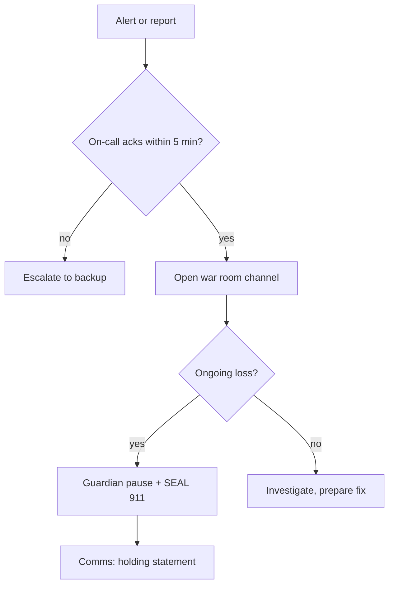

# Preparation: Runbooks, Pause Roles and Contacts

In on-chain incidents the response is mostly decided before the incident starts. Whether you can pause, how fast signers respond, who you can call to freeze funds and how you tell users what to do all depend on work done in calm conditions. This chapter covers the technical controls, people and documents that preparation should produce.

## Emergency controls in contracts

Decide during design which emergency powers exist and who holds them. Common patterns:

| Control | What it does | Trade-off |
|---|---|---|
| Global pause | Stops all state-changing user functions | Simple; also stops users withdrawing |
| Granular pause | Pauses specific markets, functions or chains | More targeted; more complex to test |
| Guardian role | A small, fast multisig or key that can pause but not upgrade | Fast response; must be tightly scoped |
| Rate limits / circuit breakers | Cap outflows per period; trip automatically on anomalies | Limits losses without human action; can block legitimate large withdrawals |
| Upgrade via timelock | Fix code after a delay | Safe for normal changes; too slow for emergencies unless paired with pause |
| Allowlisted withdrawal-only mode | Users can exit but not deposit or borrow | Protects users while containing risk |

The guardian pattern is widely used: a fast path that can only make the system safer (pause, lower limits) and a slow, timelocked governance path for anything that could make it less safe (upgrade, unpause, parameter changes). OpenZeppelin's `Pausable` and `AccessControl` contracts provide building blocks. Emergency powers are themselves an attack surface, so scope them narrowly and monitor their use; see **smart-contract-upgrade-security** and **governance-attack-engineering**.

## Signer readiness

Multisig speed is a function of people, not contracts.

- Keep a current signer roster with time zones, primary and backup contact methods, and hardware wallet locations.
- Ensure enough signers can be reached at any hour to meet the threshold. A 4-of-7 Safe where five signers share a time zone fails at night.
- Pre-create and simulate pause transactions. Store unsigned payloads or Safe transaction templates so signers only need to verify and sign.
- Practise: run a drill on a testnet where signers execute the pause from cold, and time it.
- Verify what you sign. The Bybit incident in February 2025, attributed by the FBI to North Korean actors, involved signers approving a transaction whose displayed content did not match what they actually signed. Independent transaction decoding on a separate device is part of signer preparation.

## Contacts

Build and maintain a contact sheet before you need it:

- **SEAL 911** — the Security Alliance's emergency channel that connects teams with vetted security responders.
- **Stablecoin issuers** (for example Circle and Tether), who can freeze tokens at specific addresses under their policies.
- **Major centralised exchanges' security teams**, to flag attacker deposits.
- **Bridge operators** your assets can move through.
- **Auditors** of the affected code, who know it best.
- **Blockchain analytics firms** for tracing.
- **Legal counsel** with crypto and cross-border experience, and, where appropriate, law enforcement contacts (for example the FBI's IC3 portal in the US).
- **Integrating protocols** that hold your tokens or depend on your oracle.

Many exchanges and issuers act only on formal requests, often from law enforcement. Know their process in advance.

## Monitoring and alerting

Detection is covered in Chapter 3, but the infrastructure is a preparation task: on-chain monitors for invariants and admin actions, mempool monitoring for known exploit patterns, and a reliable paging route to on-call engineers.

## Runbooks

A runbook is a short document per scenario that a tired person can follow. Each should state the trigger, who decides, first actions with exact commands or transaction templates, communications to send, and when to escalate.

## Worked example

*Execution status: the commands, code and numbers in this example were not executed in this book's CI; they are illustrative. Verify locally on a devnet, testnet or fork before relying on them.*

Prepare and drill a guardian pause on a local devnet.

1. Deploy a toy vault using OpenZeppelin `Pausable` and `AccessControl` on Anvil, with a `GUARDIAN_ROLE` allowed to call `pause()` and a separate `DEFAULT_ADMIN_ROLE` behind a timelock for `unpause()`.
2. Deploy a Safe on a public testnet (or simulate one on Anvil with three test keys) and grant it `GUARDIAN_ROLE`.
3. Encode the pause call: `cast calldata "pause()"` and save the Safe transaction template with target, value and data.
4. Write a one-page runbook: trigger "invariant monitor reports outflow above threshold", decision-maker "on-call lead", action "propose template in Safe, signers verify calldata independently with `cast 4byte-decode` or the Safe UI, execute".
5. Run the drill with three colleagues at an unannounced time. Record time from alert to pause.
6. Verify that the guardian cannot call `unpause()` or upgrade.

## Common pitfalls

- A pause that also blocks users from withdrawing when it does not need to.
- Guardian keys with power to upgrade, not just pause.
- Contact lists that are out of date or live only in one person's phone.
- Never having executed the pause on a real network.
- Runbooks that assume a specific person is available.

## Exercises

1. Write a contact sheet template with the categories above and fill in public intake routes for three organisations.
2. Implement a per-day withdrawal rate limit in a test contract and write Foundry tests showing it caps a simulated drain.
3. Run a signer drill and write down every delay you observe.

## Further reading

- NIST SP 800-61 Rev. 3 (2025)
- OpenZeppelin Contracts: `Pausable`, `AccessControl`, `TimelockController`: <https://docs.openzeppelin.com/contracts>
- Safe documentation: <https://docs.safe.global>
- Security Alliance (SEAL): <https://securityalliance.org>
- Related books: **smart-contract-upgrade-security**, **governance-attack-engineering**, **mpc-wallet-security**
