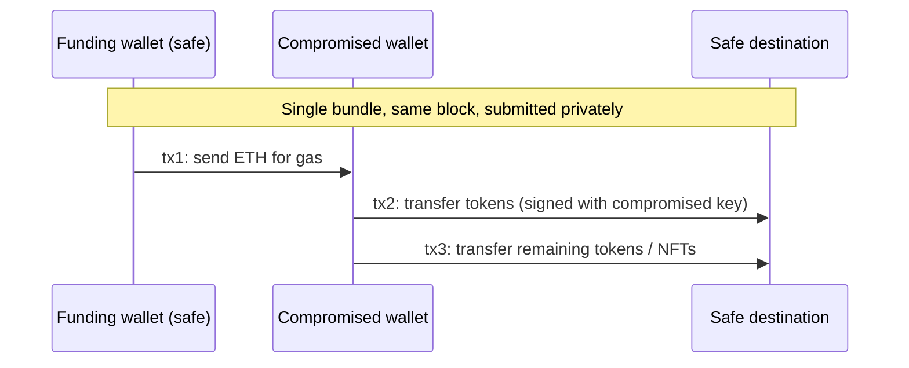

# Containment: Pausing, Guardians and Whitehat Rescues

Containment means stopping further loss. On-chain, that usually involves some combination of pausing contracts, moving remaining funds out of reach, revoking approvals, asking third parties to freeze attacker-held assets, and in some cases racing the attacker to the same vulnerable funds. This chapter covers those moves and the specific technique of private-mempool rescues.

## Containment options

| Action | Who can do it | Speed | Notes |
|---|---|---|---|
| Pause contracts | Guardian / admin | One transaction after signing | Depends on preparation (Chapter 2) |
| Raise fees / lower limits / disable markets | Admin, sometimes guardian | One transaction | Useful when pause is too broad |
| Upgrade to patched code | Admin, often timelocked | Hours to days | Usually after pause |
| Revoke approvals | Each user | Per user | Communicate clearly; link to revoke tools |
| Freeze stablecoins at attacker address | Issuer | Hours, policy-dependent | Often requires law enforcement or formal request |
| Freeze exchange deposits | Exchange | Varies | Provide addresses and transaction hashes |
| Whitehat rescue of vulnerable funds | Anyone able to execute the exploit path | Minutes | Legal and ethical questions; see below |
| Take down compromised front-end | Web/DNS team | Minutes to hours | Also warn wallets and blocklists |

Pausing is not always possible. Immutable contracts, or contracts where the pause covers only some paths, require other options. Communications become part of containment: telling users to stop depositing and to revoke approvals reduces losses directly.

## Whitehat rescues

When funds remain in a vulnerable contract that cannot be paused, defenders sometimes use the same vulnerability to move those funds to a safe address before the attacker or copycats do. Public examples include parts of the Nomad response in 2022 and the Curve/Vyper incident in July 2023, where some at-risk funds were front-run by bots and responders and later returned.

Rescues raise real problems:

- **Legality.** Executing an exploit, even with good intentions, may break computer-misuse or property laws depending on jurisdiction. Frameworks such as the Security Alliance's Whitehat Safe Harbor agreement exist so protocols can authorise rescues in advance; see **bug-bounty-security-economics**. Without such authorisation, consult counsel. This chapter is general information, not legal advice.
- **Front-running.** A rescue transaction sent to the public mempool reveals the exploit and can itself be copied. Rescues therefore use private submission.
- **Custody.** Rescued funds must go to an address the protocol controls, with clear records.

## Private mempool submission

Private transaction routes send transactions directly to block builders instead of gossiping them publicly. Flashbots Protect RPC and the Flashbots bundle API (`eth_sendBundle`) are widely used examples on Ethereum; other builders offer similar endpoints. A **bundle** is an ordered list of signed transactions that a builder includes atomically or not at all.

### Compromised key rescue

A frequent case is a compromised EOA that still holds tokens but has no ETH, while a "sweeper" bot drains any ETH sent to it within seconds. A rescue bundle does three things in one block:

Because the funding and the transfers land together, the sweeper never sees spare ETH in a public pending state. Bundles may still fail if the attacker submits competing transactions with higher payment to builders, so rescuers often pay a meaningful builder tip.

## Worked example

*Execution status: the commands, code and numbers in this example were not executed in this book's CI; they are illustrative. Verify locally on a devnet, testnet or fork before relying on them.*

Build and test a compromised-key rescue bundle on a local fork. Do not use real compromised keys or mainnet.

1. Start `anvil` and create three accounts: `funder`, `victim` and `safe`. Deploy a test ERC-20 and mint tokens to `victim`. Set `victim`'s ETH balance to zero with `cast rpc anvil_setBalance <victim> 0x0`.
2. Simulate a sweeper: a small script that polls `victim`'s balance every block and, if non-zero, sends everything to an `attacker` account.
3. Show the naive rescue fails: send ETH from `funder` to `victim` in one transaction, then try the token transfer. The sweeper wins.
4. Now disable automine (`cast rpc evm_setAutomine false`), queue `tx1` (funder→victim gas), `tx2` (victim→safe tokens) with explicit nonces and gas prices, and mine one block with `cast rpc evm_mine`. This mimics atomic bundle inclusion.
5. Confirm `safe` holds the tokens and the sweeper never saw a spendable balance between blocks.
6. On a public testnet that supports a bundle relay, repeat using a Flashbots-compatible library such as `ethers-provider-flashbots-bundle` or a bundle-capable SDK, signing with throwaway keys only. Note how simulation (`eth_callBundle`) reports success before submission.

## Containment decision record

During a real event, write down each containment decision with time, decider, rationale and transaction hash. Examples: "14:03 UTC – Guardian Safe paused markets A and B (tx 0x…), decided by on-call lead; market C left open because it uses a different oracle path." These records support the post-mortem, user communications and any legal follow-up.

## Common pitfalls

- Sending rescue transactions through the public mempool.
- Rescuing to an address the team cannot prove it controls.
- Pausing only one chain's deployment.
- Revealing the bug in public messages before containment is complete.
- Assuming exchanges or issuers will freeze funds instantly on an informal message.

## Exercises

1. Complete the worked example and extend it to rescue an ERC-721 as well as ERC-20 tokens in the same block.
2. Write a containment matrix for a protocol you know: which pause or limit applies to which function.
3. Draft a template freeze request for an exchange including all the data you would need to provide.

## Further reading

- Flashbots documentation (Protect, bundles, `eth_sendBundle`): <https://docs.flashbots.net>
- SEAL Whitehat Safe Harbor: <https://securityalliance.org>
- Revoke.cash for approval revocation: <https://revoke.cash>
- Curve/Vyper (July 2023) and Nomad (August 2022) post-incident reports
- Related books: **mev-security-engineering**, **bug-bounty-security-economics**, **ai-agent-wallet-security**
