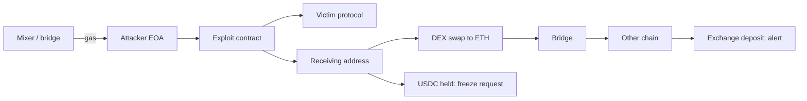

# Communication, Negotiation and Fund Tracing

After containment the incident moves into a long middle phase: keeping users informed, attempting to recover funds through negotiation or third-party freezes, and tracing where stolen assets go. These activities overlap and influence each other, so they need coordination from the same war room.

## Communication

Users, integrators, investors, journalists, attackers and copycats all read your announcements. Good incident communication is accurate, timely and specific about what users should do.

**Holding statement (first 30–60 minutes).** Acknowledge the incident, say what users should do (stop depositing, revoke approvals for specific contracts, do not interact with the front-end), and promise a next update time. Do not speculate on cause or amount.

**Updates.** Regular, timestamped, consistent across channels (X/Twitter, Discord, Telegram, website banner, status page). Pin the canonical channel and warn users that scammers will impersonate the team — fake "refund" links are a predictable follow-up to large incidents.

**Integrators and partners.** Private, direct messages to protocols that hold your tokens or depend on you, with technical detail they need.

**Disclosure of root cause.** Usually only after the vulnerability is fixed everywhere, including forks of your code. Coordinate with known forks privately first where possible.

| Audience | Channel | Content |
|---|---|---|
| Users | Public channels, banner | Actions to take, timeline, support |
| Integrators | Direct secure channels | Affected contracts, risk to them |
| Exchanges / issuers | Formal requests | Addresses, hashes, freeze request |
| Attacker | On-chain message, designated email | Offer and deadline (see below) |
| Press | Statement via comms lead | Facts only |

## Negotiation with attackers

Many protocols send an on-chain message to the attacker — typically a transaction to the attacker's address with text in the input data — offering to let them keep a portion of funds as a "bounty" in exchange for returning the rest by a deadline, sometimes stating that no further action will be pursued if they comply. Offers around 10% have been common in public cases, although amounts vary.

Public examples show the range of outcomes:

- **Poly Network (August 2021):** the attacker returned most of the roughly 600 million US dollars taken, after public exchanges with the project, according to the project's statements and press coverage.
- **Euler Finance (March 2023):** after on-chain messages and negotiation, the attacker returned the bulk of around 197 million US dollars in reported losses.
- Many smaller cases end with partial returns or none.

Points to weigh, described neutrally:

- **Legal constraints.** Offering to forgo legal action may be limited by law, cannot bind prosecutors, and payments to sanctioned parties are prohibited. The Mango Markets case (2022) showed that a governance-approved "bounty" did not prevent US criminal charges against the exploiter. Take legal advice before making offers. This chapter is general information, not legal advice.
- **Sanctions screening.** If attribution points to sanctioned actors (for example, groups the US has linked to North Korea), negotiation and any payment may be off the table.
- **Credibility and consistency.** Deadlines and escalation statements should be ones you will actually follow.
- **Evidence preservation.** Keep all messages and transactions; they matter for law enforcement and insurers.
- **Whitehat claims.** Some attackers claim they acted to protect funds. Safe-harbor frameworks agreed in advance give clearer rules than ad hoc claims.

Sending an on-chain message is simple:

```bash
# Encode a UTF-8 message as calldata and send a zero-value tx (testnet example)
MSG=$(cast from-utf8 "We are the X team. Contact security@example.org. Return funds to 0x... by 2026-01-10 12:00 UTC.")
cast send <attacker-address> --value 0 "$MSG" --private-key $TEAM_KEY --rpc-url $SEPOLIA_RPC
```

## Fund tracing

Tracing supports freezes, law enforcement, negotiation and the post-mortem. Typical steps:

1. **Label** all attacker addresses: exploit EOA, exploit contract, receiving addresses, funding source.
2. **Find the funding source.** Attackers commonly fund gas through mixers, bridges or exchanges; this sometimes yields leads.
3. **Follow outflows** across swaps, bridges and chains. Note when funds reach centralised exchanges, OTC desks or stablecoins that can be frozen.
4. **Alert** exchanges and issuers immediately when funds land where they can act.
5. **Watch** dormant addresses continuously; laundering can resume months later.

Tools include block explorers, Arkham, Breadcrumbs, BlockSec MetaSleuth and commercial platforms such as Chainalysis and TRM Labs. AI tools can cluster addresses or summarise flows, but every attribution claim must be checked against the underlying transactions; heuristics like common-input ownership are probabilistic, and wrong labels can harm innocent parties.



## Worked example

*Execution status: the commands, code and numbers in this example were not executed in this book's CI; they are illustrative. Verify locally on a devnet, testnet or fork before relying on them.*

Trace a simulated theft on a local devnet.

1. On Anvil, script a "theft": attacker account receives test tokens, swaps half on a locally deployed Uniswap v2 clone, splits ETH across five fresh addresses, and sends one portion to an address you label "exchange deposit".
2. Using only `cast` (`cast logs`, `cast tx`, `cast receipt`), reconstruct the flow from the attacker address. Record each hop in a table: from, to, asset, amount, tx hash.
3. Draw the graph in Mermaid and mark the points where a freeze could have helped.
4. Ask an AI assistant to summarise your table; check every claim in its summary against the table and mark any errors.

## Common pitfalls

- Announcing cause or loss figures before they are confirmed, then revising repeatedly.
- No warning about impersonation and fake refund sites.
- Making negotiation promises without legal review.
- Ignoring funds that go dormant.
- Publishing unverified attributions.

## Exercises

1. Draft a holding statement and two follow-up updates for a fictional exploit.
2. Reconstruct the first five hops of a public exploit's fund flow from a published post-mortem using a block explorer.
3. Write an internal policy on when the team will and will not negotiate, and have counsel review it.

## Further reading

- Euler Finance and Poly Network public statements and post-mortems
- Chainalysis Crypto Crime reports (annual)
- OFAC sanctions guidance for the virtual currency industry (2021)
- Related books: **dprk-crypto-threat-operations**, **onchain-malware-analysis**, **bug-bounty-security-economics**
