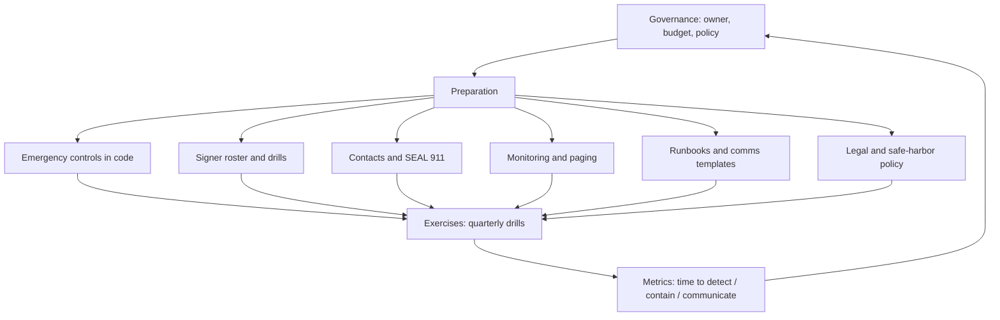

# Post-Mortems and an Incident Response Programme

An incident is not over when the attacker stops. Recovery decisions, reimbursements, root-cause fixes across every deployment, and a post-mortem that others can learn from are part of the response. This chapter covers recovery and post-mortems, then assembles the book into a programme with a checklist.

## Recovery

Recovery decisions often have lasting economic and governance consequences:

- **Unpausing.** Only after the vulnerable path is closed everywhere, the fix is reviewed (ideally by the original auditors and an independent party), and monitoring has been extended to catch the bug class.
- **Reimbursement.** Options include treasury funds, insurance or cover protocols, recovered funds, debt tokens, or a combination. Decide by governance where appropriate and publish the method.
- **Migration.** Sometimes the safest path is to deploy new contracts and let users migrate, especially if the old contracts cannot be fully fixed.
- **Key rotation.** After any key compromise, rotate all keys that shared infrastructure, people or processes with the compromised one, not just the one known to be exposed.

## Writing a post-mortem

A useful post-mortem is blameless, specific and public enough that others can check their own systems. A common structure:

1. **Summary** — what happened, impact, current status, in a few sentences.
2. **Timeline** — UTC timestamps from first malicious transaction (and earlier preparatory activity, such as contract deployment or funding) through detection, containment, communications and recovery.
3. **Root cause** — technical explanation with code references and transaction hashes.
4. **Detection and response analysis** — what worked, what did not, how long each phase took.
5. **Impact** — amounts at the time, affected users, recovered funds. Mark figures as estimates where they are.
6. **Remediation** — fixes, with links to commits and audits.
7. **Lessons and follow-ups** — action items with owners and dates.

Time to detect, time to contain and time to communicate are the metrics that matter most for improving the programme. Record them consistently across incidents and drills.

Avoid presenting uncertain attribution as fact. If law enforcement or analytics firms have attributed the incident, cite them; otherwise say what is known and what is not.

## Learning from others

Public post-mortems are a free training set. Reading them by category (oracle manipulation, upgrade errors, key compromise, front-end hijack) and asking "could this happen here?" is a cheap, effective exercise. Turning each incident into an audit question works well:

| Incident type (example) | Audit question for your protocol |
|---|---|
| Initialisation error after upgrade (Nomad, 2022) | Do we simulate every upgrade on a fork and check critical state after it? |
| Multisig signers misled about transaction content (Bybit, 2025) | Can each signer independently decode what they sign? |
| Validator / bridge key compromise (Ronin, 2022) | How many keys, held by how many independent parties, does it take to move funds? |
| Compiler-level reentrancy lock bug (Curve/Vyper, 2023) | Do we track compiler advisories for the versions we deployed with? |

## Programme overview

## Worked example

*Execution status: the commands, code and numbers in this example were not executed in this book's CI; they are illustrative. Verify locally on a devnet, testnet or fork before relying on them.*

Run a full tabletop exercise and produce a post-mortem.

1. **Scenario.** A facilitator prepares an Anvil fork scenario: a lending protocol whose oracle can be manipulated through a thin liquidity pool. The facilitator scripts the attack transactions in advance.
2. **Start.** At an unannounced time, the facilitator triggers the first attack transaction and an alert.
3. **Respond.** The team follows its runbooks: triage, pause through the test guardian Safe, holding statement draft, contact sheet usage (simulated), and fund tracing on the fork.
4. **Inject.** At +20 minutes the facilitator injects complications: a copycat transaction, a fake "refund" tweet, a signer unavailable.
5. **Stop at +90 minutes** and collect timestamps from the channel log.
6. **Write the post-mortem** using the structure above. Example metrics from a drill: detection at +2 minutes, pause at +31 minutes (delayed by one unavailable signer), holding statement at +44 minutes.
7. **Action items.** For example: add a fourth time zone to the signer set, pre-approve holding statement text, add an oracle deviation monitor.

## Checklist

**Preparation**

- [ ] Named incident owner and deputy; decision rights written down.
- [ ] Guardian pause and granular controls deployed and tested on a public network.
- [ ] Signer roster covering all time zones; drill in the last quarter.
- [ ] Contact sheet: SEAL 911, issuers, exchanges, bridges, auditors, analytics, counsel.
- [ ] Monitoring for invariants, admin actions and upgrades on every chain; paging tested.
- [ ] Runbooks per incident category; comms templates; impersonation warning ready.
- [ ] Safe-harbor and negotiation policy reviewed by counsel.

**During an incident**

- [ ] War-room channel with timestamped log.
- [ ] Triage questions answered and recorded.
- [ ] Containment decisions recorded with hashes.
- [ ] Holding statement within an hour.
- [ ] Freeze requests sent where funds can be frozen.

**After**

- [ ] Fix deployed everywhere; forks notified.
- [ ] Post-mortem published with timeline and metrics.
- [ ] Action items tracked to completion.

## Common pitfalls

- Post-mortems that blame individuals and therefore hide process failures.
- Unpausing before the fix covers every deployment.
- Rotating only the obviously compromised key.
- Drills that are announced and scripted so no one is surprised.
- No metrics, so improvement cannot be shown.

## Exercises

1. Run the tabletop above with your team and publish an internal post-mortem.
2. Choose three public post-mortems and turn each into an audit question for your own protocol.
3. Build a simple spreadsheet tracking time to detect, contain and communicate across drills and incidents.

## Further reading

- NIST SP 800-61 Rev. 3 (2025)
- Google SRE book, chapter on postmortem culture: <https://sre.google/sre-book/postmortem-culture/>
- Security Alliance resources: <https://securityalliance.org>
- Related books: **smart-contract-upgrade-security**, **oracle-security-engineering**, **dprk-crypto-threat-operations**, **cross-chain-bridge-security**
